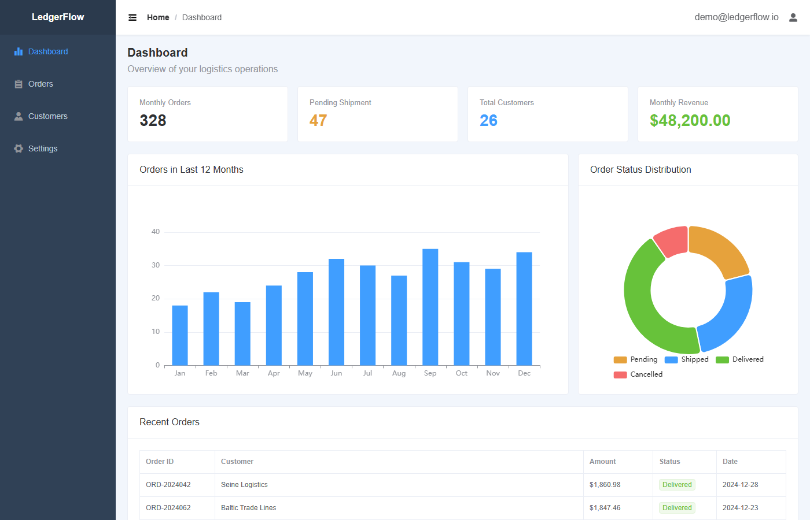
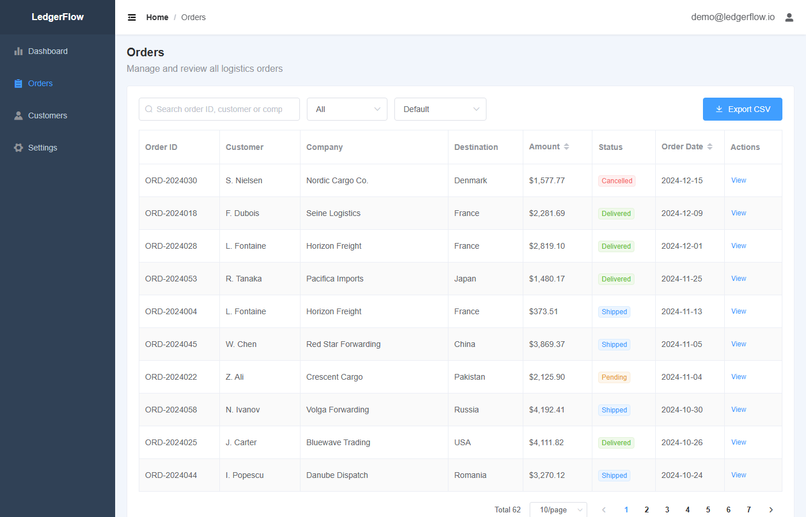
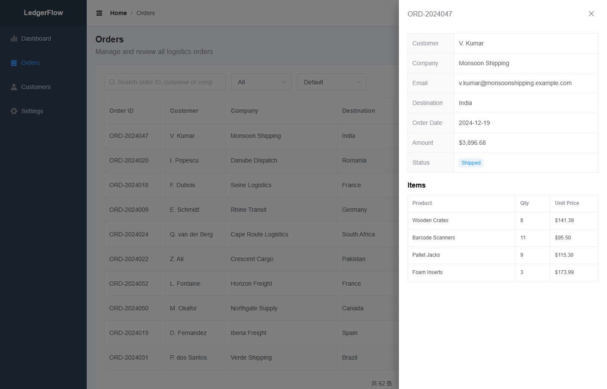
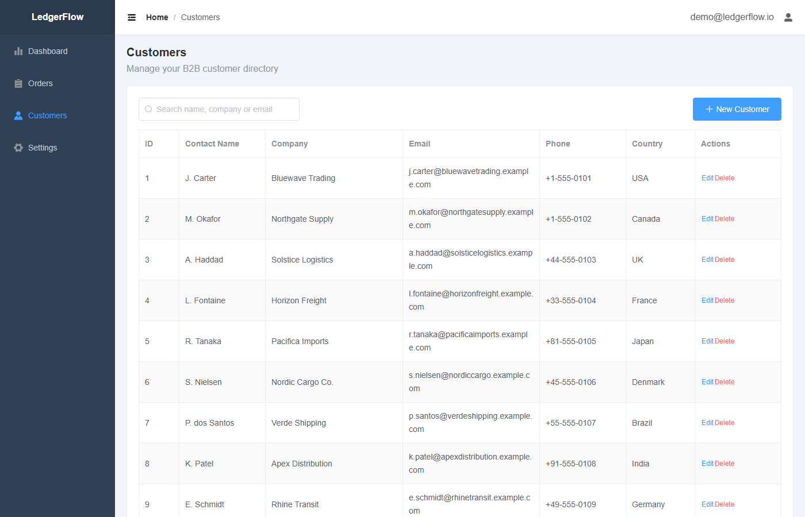

# LedgerFlow Admin

A demo of a typical Vue 2 era B2B admin (Options API, Element UI, Vuex 3) — also serves as the "before" state for a Vue 2 to Vue 3 migration audit sample.

LedgerFlow Admin is a fictional small-to-medium logistics order management dashboard. All data is mocked in memory; there is no real backend, authentication, or persistence.

## Tech Stack

- Vue 2.7 (Options API)
- Vue Router 3
- Vuex 3
- Element UI 2.15
- ECharts 5
- vue-cli / webpack 5

## Run

```bash
npm install
npm run serve
```

The dev server starts on http://localhost:8080 by default.

## Features

- Collapsible sidebar layout with breadcrumb
- Dashboard KPI cards and ECharts visuals
- Orders list with pagination, status filter, keyword search, amount sorting, detail drawer and CSV export
- Customers CRUD in memory
- Settings form placeholder

## Screenshots









## License

MIT
